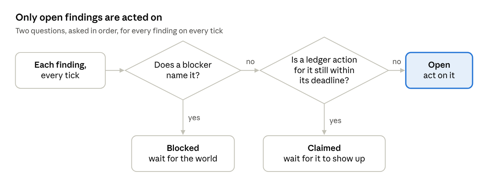
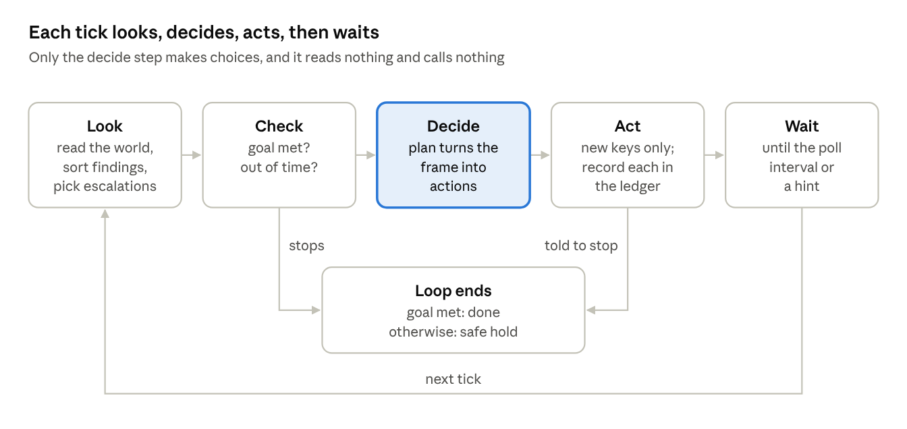

# Reconciler Loops: A Developer Introduction

Oct 31, 2026 · @Christopher Rocco

## What this is

A reconciler loop is a way to write agent workflows that run for minutes, days or weeks without losing track of what they are doing. On every pass, the loop re-reads the real systems (bug tracker, deploy system, metrics), works out what is wrong and what is already being handled, takes at most one safe action per problem, and waits. It runs inside a durable workflow engine such as Temporal.

It is mostly a design pattern. Like Redux, you can write it yourself with a little boilerplate: the core is about 150 lines. We also provide a library that implements the parts that are easy to get subtly wrong, plus logging and test tooling. Section 9 lists exactly what you must get right if you write it yourself.

Unlike Redux, it is not event-driven. Redux treats events as the source of truth and keeps state in a store you own. A reconciler loop treats the outside world as the source of truth and uses events only as a cue to look again. Its real ancestor is the Kubernetes controller, which keeps a cluster matching its desired state the same way.

**Running example.** This document uses one loop throughout: an agent that ramps an experiment through traffic stages (1%, 5%, 25%, 50%, 100%), watches its guardrail metrics, and responds when one of them regresses. Section 7 adds a second, contrasting example: an assistant that guides a code change through review. Section 8 adds a third: moving a large codebase from one JavaScript framework to another.

## Why not just react to events?

The obvious way to write the experiment agent is event-driven: when a guardrail breaches, roll back; when the fix deploys, advance. That works for a demo and breaks over weeks, in four predictable ways:

1. **Events get lost.** A webhook is dropped, a worker restarts between receiving an event and acting on it, or a signal arrives before the workflow has started.
2. **The workflow's memory gets lost.** Workflows are terminated, reset after a bad deploy, or replaced by incompatible code. Everything the workflow knew ("I filed bug 123", "I'm waiting for CL 77") is gone, but its effects are still out in the world.
3. **People act on their own.** Someone closes the bug, ships their own fix, or rolls the experiment back by hand. A workflow waiting for its own event never notices.
4. **History grows.** A workflow that runs for weeks builds up an event history the engine eventually cannot replay.

A reconciler loop avoids all four by not depending on events or memory at all. It re-reads the world on every pass, so a lost event only delays it, a fresh workflow with no memory picks up where the old one left off, and a person's change is simply seen. The durable workflow engine covers the remaining gap: it makes each individual pass safe against crashes.

## Core concepts

This section builds the model one idea at a time, and each idea uses only the ones before it. A new term is in **bold** where it is defined. The glossary at the end collects them all.

### 1. The world

The loop works on systems it does not own: the experiment service (where the experiment lives), the metrics pipeline, the bug tracker, code review and the deploy system. Together, these are **the world**.

Other people and tools change the world too, at any time. The world is the source of truth: when the loop and the world disagree, the world is right.

### 2. Looking again: the tick

The loop runs as a repeating cycle. Each cycle is a **tick**, and it does four things: look at the world, decide what to do, do it, then wait. Then the next tick starts.

A tick never relies on what an earlier tick concluded; it looks again. That is the key difference from an event-driven design. An event, such as a webhook, does not tell the loop what to do. It only wakes the loop early so it looks sooner, and if the event is lost, the loop still looks at its next scheduled time.

*Example:* every hour, or sooner if woken, the loop reads the experiment's current stage, its guardrail readings and any related bugs.

### 3. The goal

Most loops have a goal, written as a check on the world: "the experiment is at 100%, or its owner has stopped it." Each tick checks the goal first, and when it is met, the loop finishes. A loop that never finishes, such as an on-call agent, has no goal (concept 14). In code, this check is called `done`.

### 4. Findings

A **finding** is something wrong in the world that stands between the loop and its goal, or that the loop exists to keep fixed. For example: "the experiment's guardrails are regressed."

Findings are worked out fresh on every tick from what the loop just read. Nothing stores them.

A finding is a state, not an event. "Guardrails are regressed right now" is a finding. "We detected a regression at 10:00" is not: that is an event, and the loop does not keep events. If the metrics recover, the finding simply stops appearing.

A finding is the thing the loop responds to, so size it to the response. When ten correlated latency metrics fail together, they almost always fail for one reason, and the response is one debugging session. So the experiment loop has one finding for the whole regression, with the failing metrics as its data, not ten findings (section 6 explains the choice).

### 5. A finding's id

Each finding has an id, which is how the loop recognizes the same problem from one tick to the next. The id follows two rules:

- **Same problem, same id.** The experiment's regression is `regression:s2` on every tick: a regression found once the ramp has reached stage 2. The id never includes anything that changes while the problem does not, such as the current metric values, which metrics are failing right now, or the time.
- **New response needed, new id.** In a code review loop, each reviewer comment is a finding. If the reviewer writes again, that needs a new answer, so the id changes from `thread:t3@msg3` to `thread:t3@msg7`.

The id matters because everything that follows hangs off it. Actions name the findings they address, retries are counted per id, and records in the world are labeled with it.

### 6. Actions and keys

To respond to a finding, the loop takes an **action**: roll back a stage, submit a fix, file an issue. Every action has a **key**, a name such as `fix:regression:s2:1`. Two rules make keys work:

- **An action with a given key happens at most once.** The loop checks this itself (concept 7), and the system receiving the action checks too. The fix CL, the bug and the page each store the key and ignore a repeat.
- **Keys are built only from what the loop sees.** Never from randomness or the clock. So a fresh workflow looking at the same world proposes the same keys, and the receiving systems ignore the ones that already happened.

The `:1` at the end is the attempt number, which concept 10 explains.

### 7. The ledger: the loop's only memory

The loop keeps one list of its own: every action it has taken, by key. This list is the **ledger**. It does two jobs.

First, it stops the loop from repeating an action. Second, it covers a gap in what the world shows. Some actions are finished the moment they run, like a rollback. Others only show up in the world later: a submitted fix can take minutes to appear in the deploy system. During that gap the world shows nothing, so the ledger is the only record that the loop already acted.

For actions of the second kind, the loop sets a **deadline** for them to show up, such as one hour. If no sign of the action appears in the world by then, the loop assumes it was lost and treats the finding as unhandled again.

The ledger lives in the workflow's memory, so it is lost if the workflow is terminated. That is acceptable by design. Once an action shows up in the world, the world remembers it (concept 8), and the receiving systems' key checks catch the rest.

### 8. Blockers: the world's record of work in progress

Many actions create something that lasts: an open issue, a fix CL that is rolling out, a page to on-call. The loop finds these in the world on every tick, through a label naming the finding they handle. Each one is a **blocker**: proof in the world that a finding is already being handled.

A blocker is kept separate from its finding because the two can come and go independently. After a rollback, traffic drops below the level where the regression shows, so latency recovers and the finding disappears. But the fix is still rolling out, so its blocker still exists, and it keeps the loop from moving forward until the fix lands. If "being handled" were only a status on the finding, it would have disappeared along with the finding.

The loop never stores blockers. Like findings, they are re-read on every tick. That is what lets a person close the bug by hand: the next tick simply sees it closed.

A blocker can also mean "something else comes first" rather than "someone is working on it". In a migration, a component may have to wait until the components it uses have moved. That kind of blocker is a **prerequisite**. The loop reads it from the world like any other blocker, and leaves the finding alone until it clears.

### 9. Sorting findings: open, claimed, blocked

On every tick, the loop sorts each finding into one of three groups by asking two questions in order:

1. Does a blocker in the world name this finding? Then it is **blocked**: something in the world is handling it.
2. If not, does the ledger hold an action for it that has not shown up yet and is still within its deadline? Then it is **claimed**: the loop just acted, and the world has not caught up.
3. Otherwise, it is **open**: nothing is handling it.

The loop only acts on open findings. Blocked and claimed findings are already covered, so acting again would duplicate work. When both a blocker and the ledger cover a finding, the blocker wins, because the world is the source of truth.

The group is not stored anywhere. It is recomputed on every tick from three things: the findings, the blockers and the ledger.



The blocker question comes first, so once the world shows the work, the ledger entry no longer matters.

### 10. Attempts and retries

Sometimes a response does not work: the fix lands, and latency is still regressed. The finding comes back as open, and the loop should try again.

A finding's **attempts** is the number of ledger entries that name it. The next action's key carries the next attempt number: `fix:regression:s2:1`, then `fix:regression:s2:2`. Without the number, the retry would have the same key as the first fix, the loop would skip it as already done, and nothing would happen.

Attempts also tell the loop when to stop trying on its own. After a set number, three in our example, it hands the finding to a person instead (concept 13).

### 11. The frame

Everything above, gathered for one tick, is the **frame**. It holds what the loop read from the world, the findings sorted into open, claimed and blocked, the blockers, the attempt counts, whether the loop is held (concept 12), and which findings are being handed to a person (concept 13).

The frame is a snapshot: nothing changes it during the tick. The tick's deciding step (`plan` in code) takes the frame and returns a list of actions. It reads no systems and calls nothing, which makes it easy to test: build a frame, check the actions.

### 12. Holding and moving forward

The loop does two kinds of work: responding to findings, and moving toward its goal, such as advancing a stage. They follow different rules.

A blocker can do one of two things. It can cover only the findings it names. Or it can also **hold** the whole loop. An open issue against the experiment holds it: no stage advances while that issue is open, even if every metric looks fine. By contrast, in a code review loop, a draft reply waiting for the owner's approval covers only its own thread, and the agent keeps answering the others.

The loop moves forward only on a **clean frame**: no findings, no blockers and nothing claimed. So "never advance while something is outstanding" is not a check someone has to remember to write. It follows from this rule.

### 13. Handing a finding to a person

When the loop cannot resolve a finding on its own, it does not stop. It **escalates** that finding: it files an issue assigned to a person, with a key such as `escalate:regression:s2:4`. That issue is a blocker, so the finding becomes blocked, and the loop carries on with everything else.

A finding is escalated in three cases:

- **Out of attempts.** It is open and has used its attempts, three in our example, since it was last escalated.
- **Too old.** It has been open or blocked for longer than its **age limit**, seven days in our example. This catches stuck work, such as an issue nobody is working on. Age counts only from when work actually began: the loop's first action on the finding, or an obligation someone owns. Waiting on a prerequisite, or in a queue the loop has not reached yet, does not count.
- **Repeating itself.** Every action the plan proposed for it was already in the ledger. This means a key is missing its attempt number, so the loop also logs an error for whoever owns the loop's code.

While a finding is being escalated, `plan` can add a safety action for it. The experiment loop rolls back to stage 0. The escalation's issue then holds the loop, so the experiment waits for the person without the workflow ending.

When the person closes the issue, the loop looks again. If the finding is gone, the loop carries on. If it is still there, the agent gets a fresh set of attempts before escalating again.

### 14. When the loop stops

Because findings are escalated one at a time, very little ends a loop:

- **Goal met.** The loop is done.
- **Out of time.** Only loops meant to finish have a time budget: 60 days for the experiment. A loop that never finishes, such as an on-call agent, has no goal and no time budget, and runs until someone cancels it.
- **Told to stop.** The plan itself says to stop. The tick still runs that plan's actions first, so a safety rollback in the same plan still happens.

Stopping without meeting the goal puts the experiment in a **safe hold**: it goes back to stage 0, and a person takes over.

### Putting it together

Findings say what is wrong. Blockers say what the world is already doing about it. The ledger says what the loop just did that the world does not show yet. Each tick sorts the findings using those three, acts only on the open ones, numbers every retry, hands anything it cannot fix to a person, and moves forward only when nothing is outstanding.

Here is one regression, in latency, from start to finish:

| Tick | What the loop sees | The regression is | What the loop does |
| --- | --- | --- | --- |
| 1 | Latency failing at stage 2. No issue, no fix. | Open | Rolls back to stage 1; submits `fix:regression:s2:1` |
| 2 | Still failing (metrics lag). The deploy system does not list the fix yet. | Claimed | Nothing; checks again in 5 minutes |
| 3 | The deploy system lists the fix CL, labeled for this finding. | Blocked | Nothing; the loop is held |
| 4 | The fix is live and the CL is gone. Fresh metrics are not in yet. | No finding | Nothing; waits for readings |
| 5 | All readings pass, and the time at stage 1 is up. | No finding | Clean frame: advances to stage 2 |

## The tick, in code

The whole loop fits in one generic function, `reconcile()`, in `src/core/reconcile.ts`. Every loop runs on it: the experiment ramp, code review, and the investigation behind each issue. A loop hands it a spec, the functions described in section 5, and `reconcile()` does the rest. Each step maps to a concept from the previous section.



If a tick acted, the loop skips the wait and looks again right away, at most 10 times in a row.

```ts
export async function reconcile<W, F extends Finding, A extends Action, J = never>(
  rt: Runtime,
  spec: ReconcilerSpec<W, F, A, J>,
  opts: ReconcileOptions = {},
): Promise<Outcome<W, F>> {
  const mem: LoopMemory = opts.memory ? migrate(opts.memory, rt.now()) : newMemory(rt.now());
  const budget = spec.budget ?? {};
  const memo = memoOver(mem, rt);
  let runTicks = 0;
  let actingStreak = 0;
  let woke: string | undefined = mem.tick === 0 ? 'start' : 'resume';

  for (;;) {
    const now = rt.now();
    const ctx = { now, tick: mem.tick, memo, facts: mem.facts };

    // 1. OBSERVE — facts from systems of record; the frame adds the ledger, sorts the
    // findings, and picks out the ones to hand to a person.
    forget(mem, now, budget);
    const obs = await spec.observe(ctx);
    let frame = buildFrame<W, F, J>(obs, mem, now, budget);

    // 2. GOAL MET? Checked first, so a loop that succeeded is never reported as out of time.
    const doneReason = spec.done?.(frame);
    if (doneReason) return { status: 'done', reason: doneReason, frame, memory: mem };

    // 3. OUT OF TIME? Only finite loops have a time budget. Checked against the lineage.
    const late = outOfTime(mem, now, budget);
    if (late) return { status: 'out-of-time', reason: late, frame, memory: mem };

    // 4. ASSESS — memoized judgments on open findings only.
    if (spec.assess && frame.open.length) {
      const assessments = await spec.assess(frame.open, { ...ctx, attempts: frame.attempts });
      frame = { ...frame, assessments };
    }

    // 5. PLAN — pure.
    const plan = spec.plan(frame);

    // 6. ACT — the loop's escalations first, then the plan's actions; never repeat a key.
    const act = (actions: (A | EscalateAction)[]) => runActions(actions, mem, rt, (a) => spec.act(a, frame, mem.facts));
    const { acted, skipped } = await act([...frame.escalating.map((e) => escalation(e, frame, budget)), ...plan.actions]);

    // REPEATING ITSELF — an open finding whose every proposed action was already taken can
    // never be acted on again (the plan is pure and the ledger never repeats a key). A key
    // is missing its attempt number: hand the finding to a person and report it.
    const stalled = stalledFindings(plan.actions, skipped, frame);
    if (stalled.length) {
      const reason = 'the plan only repeats actions already taken';
      acted.push(...(await act(stalled.map((f) => escalation({ finding: f, reason }, frame, budget)))).acted);
    }

    opts.onTick?.({
      loop: spec.name, tick: mem.tick, at: now,
      findings: ids(frame.findings), open: ids(frame.open), blocked: ids(frame.blocked),
      claimed: ids(frame.claimed), escalating: ids(frame.escalating.map((e) => e.finding)),
      stalled: ids(stalled), blockers: frame.blockers.map((b) => b.id), held: frame.held,
      acted, skipped, note: plan.note, woke,
    });
    mem.tick += 1;
    runTicks += 1;

    // 7. TOLD TO STOP? Only after acting, so a safety rollback in the same plan still runs.
    if (plan.halt) return { ...plan.halt, frame, memory: mem };

    // 8. WAIT — if we changed the world, look again now (up to maxImmediateTicks in a row);
    // otherwise sleep until poll/hint.
    actingStreak = acted.length ? actingStreak + 1 : 0;
    if (acted.length && actingStreak <= (opts.maxImmediateTicks ?? 10)) {
      woke = 'acted';
    } else {
      const r = await rt.wait({ timeoutMs: plan.wake.afterMs, signals: plan.wake.signals });
      woke = r.reason === 'signal' ? `signal:${r.name}` : 'timeout';
    }

    // 9. CHECKPOINT — bound history; everything needed to resume is in `mem`.
    if ((opts.maxTicksPerRun && runTicks >= opts.maxTicksPerRun) || rt.historyLarge?.()) return { status: 'checkpoint', memory: mem };
  }
}
```

Notes on the steps:

1. `forget` first drops old ledger entries and stored judgments (section 10). `observe` reads the world and returns findings and blockers. `buildFrame` adds the ledger, sorts each finding into open, claimed or blocked, counts attempts, and picks out findings to escalate (concept 13).
2. The goal comes first. A loop that has both succeeded and run out of time reports success. A loop that never finishes has no `done`.
3. Steps 3 and 7 are the only ways to end early (concept 14). `reconcile()` returns either one to the workflow that called it, which puts the experiment in a safe hold (below).
4. `assess` asks an agent for judgments on open findings only, and stores each one once (section 6). `plan` is the only place decisions are made, and it is pure.
5. The loop's escalations run first, then the plan's actions. `runActions` runs each action whose key is not yet in the ledger, records it, and skips the rest. The spec's `act` is where an action's effect actually happens.
6. A finding whose proposed actions were all skipped is escalated on the spot. The tick record lists it under `stalled`, and the Temporal logger reports it as an error for the loop's owner.
7. `onTick` receives one record per tick. In Temporal, `logTick` writes it as one log line (section 10).
8. Steps 8 and 9 deal with waiting and history, using two Temporal features. A **signal** is a message sent to a running workflow; here signals are hints that wake the loop early, or answers to questions (section 6). **Continue-as-new** ends the current workflow run and starts a fresh one with the same id, carrying only the memory passed to it, which keeps history small (section 10).
9. If a tick acted, the loop looks again right away, because its actions probably changed the world. It does this at most 10 times in a row, so a plan that keeps acting against a world that never changes cannot spin forever.

The experiment workflow in Temporal (`examples/temporal-workflows.ts`) is a thin wrapper. It continues as new on a checkpoint, and turns either early ending into a safe hold:

```ts
export async function experiment(input: ExperimentInput & { memory?: LoopMemory; answers?: Record<string, unknown> }) {
  const rt = temporalRuntime({ autoApprove: [] }, input.answers);
  const out = await reconcile(rt, experimentSpec(rt, expActs, input, rt.decisions), { memory: input.memory, maxTicksPerRun: 300, onTick: logTick });
  if (out.status === 'checkpoint') return continueAsNew<typeof experiment>({ ...input, memory: out.memory, answers: rt.decisions.snapshot() });
  if (out.status !== 'done') {
    const expId = out.memory.facts.experimentId as string | undefined;
    if (expId) await expActs.setStage(expId, 0, `exp:${input.flagName}/safe-hold`);
    await expActs.escalate(input.flagName, out.reason);
  }
  return out.status;
}
```

The code is split by what each part knows:

- `src/core/reconcile.ts` holds everything generic, as plain TypeScript: `reconcile()`, `buildFrame`, escalation, forgetting, and reading memory written by older versions.
- `src/core/runtime.ts` names the few things the loop needs from a workflow engine: the time, waiting for a poll or a hint, starting child workflows, and sending hints. `src/runtime/temporal.ts` provides them for Temporal, together with answers to questions and `logTick`. `src/runtime/sim.ts` provides them in simulated time for tests.
- `src/core/decisions.ts` holds questions for people (section 6).
- `src/scenarios/experiment.ts` holds what is specific to experiments: its spec (`observe`, `assess`, `done`, `plan` and `act`) and the workflow that adds the safe hold.

A new loop reuses the core and the runtime, and writes its own scenario file.

## Writing a loop

To write a new loop, you define three types, a spec of up to five functions, and the workflow that runs it. `reconcile()` does the rest.

**The types:**

- **The world:** what your loop reads each tick, such as the experiment, its guardrail readings and its open issues.
- **Your findings:** each kind of problem, with its id scheme (concept 5).
- **Your actions:** each kind of action and the data it carries. An action that shows up in the world later also carries a `deadlineMs` (concept 7).

**The functions:**

| Function | What it does | Pure? |
| --- | --- | --- |
| `observe` | Reads the world. Returns the raw data, the findings and the blockers. | No: it calls the systems |
| `assess` | Optional. Asks an agent for judgments on open findings, stored once each. | No: it calls the agent |
| `done` | Checks the goal against the frame. Left out for a loop that never finishes. | Yes |
| `plan` | Turns the frame into actions. | Yes |
| `act` | Carries out one action, including the loop's own escalate action. The only place remembered facts are written. Must be safe to repeat with the same key. | No: it changes the world |

The workflow calls `reconcile()` with the spec, continues as new when it returns a checkpoint, and decides the **safe hold**: what happens when the loop runs out of time or is told to stop.

We recommend writing `observe` in two parts: one function that fetches the raw data, and a pure one that turns raw data into findings and blockers. The pure part can then be tested on its own: given these readings, expect these findings.

### The shape of `plan`

Every `plan` does three things, in this order:

1. **Repair.** Fix anything the world shows is missing. For example, if an open issue's workflow has died, restart it. In the experiment loop, mounting or creating the experiment also happens here.
2. **Respond.** For each open finding, propose the response, with the attempt number in every key. For each finding being escalated, propose only a safety action, if there is one; the loop files the escalation itself.
3. **Move forward.** Only on a clean frame: advance a stage, submit, or close. A loop that never finishes skips this part.

A sketch of the experiment loop's `plan`, following the issue convention in section 6:

```ts
export function plan(frame: ExperimentFrame): Plan<ExperimentAction> {
  const actions: ExperimentAction[] = [];

  // Respond: a safety rollback, plus one issue that owns the fix.
  for (const f of frame.open) {
    const attempt = (frame.attempts[f.id] ?? 0) + 1;
    actions.push({ kind: 'set-stage', key: `rollback:${f.id}:${attempt}`, targets: [], stage: stageBelow(frame) });
    actions.push({ kind: 'file-issue', key: `issue:${f.id}:${attempt}`, targets: [f.id], deadlineMs: HOUR });
  }

  // Being escalated: the loop files the escalation; the plan only adds the safety action.
  for (const { finding } of frame.escalating) {
    const attempt = (frame.attempts[finding.id] ?? 0) + 1;
    actions.push({ kind: 'set-stage', key: `safe-hold:${finding.id}:${attempt}`, targets: [], stage: 0 });
  }

  // Move forward: only on a clean frame, with every reading passing and the soak time up.
  if (isClean(frame) && allReadingsPass(frame) && soakElapsed(frame)) actions.push(advance(frame));

  return { actions, wake: { afterMs: wakeFor(frame) } };
}
```

The rollback names no findings in `targets`, so it does not count as an attempt. Only the issue does. Otherwise, each regression would use up two of the three attempts at once.

### If the loop needs an agent's judgment

Some decisions need a model, such as "is this regression real, and how should we respond?" That call does I/O, so it cannot go inside a pure `plan`. Put it in a step between building the frame and `plan`, conventionally called `assess`. It runs only on open findings, and the frame carries its results to `plan`. Section 6 covers how to store these judgments so they are made once.

### Checklist

1. Write the goal as a pure check on what the loop observes, or leave it out for a loop that never finishes.
2. List the systems your loop reads and changes. Write one function per read and one per change. Make every change safe to repeat with the same key.
3. Choose finding ids: the same while the problem is the same, new when a new response is needed.
4. For each action that creates something lasting, decide how a fresh run will find it in the world: a label naming the finding.
5. Write `plan` as repair, then respond, then move forward on a clean frame.
6. Put the attempt number in every key whose action might fail or be lost.
7. Set each deadline close to how long that action really takes to show up.
8. Set the attempt limit and the age limit, and decide who receives escalations. For a loop meant to finish, also set a time budget and decide what the safe hold does. A loop never quietly drops a finding it could not fix: it hands it to a person.
9. Before reporting progress, confirm the effect: a fix that landed is not the same as a fix that worked.

## Conventions

The concepts say what a loop must do. These conventions are our recommended way of doing it, so that every loop we build behaves the same way.

### Put what changes into the key

An action meant to happen again needs something in its key that changes between the first time and the next. For retries, that is the attempt number (concept 10). For moving forward again after a rollback, it is the time the current stage began: `advance:1->2@<stage start time>`. The first advance from stage 1 to 2 and a second one after a rollback then have different keys.

### Size a finding to its response

Decide what a finding is by asking what the loop does about it. One response, one finding.

In the experiment, guardrail metrics are heavily correlated: a slow cache makes p50, p90 and p99 latency, CPU and timeouts all regress at once. The response is one debugging session, which finds one cause or several. So the loop groups every failing guardrail into one finding, `regression:s2`, with the failing metrics as its data. One triage looks at all of them, one issue owns the investigation, and the finding's attempts and age count once. If the investigation finds two separate causes, it files a sub-issue for each: splitting is the investigation's job, not the ramp's.

The id needs care, because the set of failing metrics changes during the episode: one recovers, another joins. So the id leaves the metrics out and names what the problem is relative to: the highest stage the ramp has reached. It stays the same through a rollback, through a fix that doesn't work, and when the same problem comes back after the ramp moves forward again. Only reaching a new stage gives a new finding. Anchoring it on the time of the last advance would look tidier, but every recurrence would then be new, with fresh attempts and a fresh age, and a problem nobody can fix would never be escalated.

The other way to group is in `plan`: one finding per metric, and one action whose targets are all of them. That suits items that really are independent and are only handled together, like review threads addressed in one revision. For correlated items it breaks down over time. A metric that starts failing mid-investigation arrives as a new open finding that the issue's blocker doesn't cover, so the loop either files a second issue or, if the key is anchored on the episode, finds the key already spent and escalates the finding as "repeating itself". Every metric also ages and escalates on its own. Grouping in `observe` keeps one key, one blocker, one attempt count and one age.

### Make each agent judgment once

An agent's judgment, such as classifying a regression, is slow and costs money. Store each result in the loop's memory under a key made of the finding id and attempt number, for example `triage:regression:s2:1`. The judgment is then made once per attempt, survives continue-as-new, and is never paid for twice.

If you log judgments as training data, log them at the same point, once per stored result. Using the same key lets you later join each judgment with what happened next, such as whether the finding came back as attempt 2.

The agent chooses a label, such as "quick fix" or "investigate". The `plan` code turns that label into actions and builds their keys. An agent never writes a key itself, because a key has to be the same every time the loop sees the same world.

### Mitigate locally, delegate durably

When a finding needs more than a quick fix, the loop takes two actions:

- **Mitigate.** A safety action that this loop owns, taken right away, such as rolling back a stage. Only the loop that owns the experiment ever changes its stage.
- **Delegate.** File one **issue** in the bug tracker, labeled with this loop and the finding id. The issue is the lasting record of the problem, and an issue loop of its own works on it: triage, fix, check that the fix worked. The open issue is a blocker that holds the parent loop until it closes.

This keeps each loop small. A loop only needs to know how to detect its findings, how to make them safe, and when to move forward. Everything about fixing problems lives in one shared issue loop, which can file sub-issues for problems it discovers along the way.

Not every finding deserves an issue. Delegate when the response takes more than a tick or two, needs authority the loop does not have, or must be visible to people. Otherwise act directly: in a code review loop, the response to a comment is a revision, not an issue. To avoid filing issues for noise, confirm a finding before delegating, for example by requiring two failing readings in a row.

### Keep remembered facts few and safe to lose

As a rule, the loop reads everything from the world. Occasionally the world cannot show something the loop needs. The experiment service has no field for "which workflow manages this experiment", so the experiment loop keeps the experiment's id in its own memory, next to the ledger.

Each such fact should be named, rare, and safe to lose. If the experiment loop loses the id, it looks for experiments on its flag and asks again whether to use the one it finds: one repeated question, not a duplicate experiment. When it creates an experiment, it first checks whether one with the same launch bug already exists, so a retried create cannot make a second one.

In code, these facts live in the memory's `facts`. Retention never forgets them, and only `act` writes them.

### Questions for people

Some steps need a person to decide, such as using an existing experiment or creating a new one, or approving the fields an agent suggested. These go through a shared decision component. A question waiting for an answer holds the loop. Answers arrive by Temporal signal. Each kind of question can be set to let the agent approve its own suggestion instead of waiting, much like permission settings in Claude Code.

In code, `observe` reads answers from the decision component (`Decisions`), so `plan` stays pure, and turns each unanswered question into a blocker that holds the loop. In Temporal, answers arrive on the `reconciler.answer` signal, a query lists the open questions, and answers are carried across continue-as-new so nobody is asked twice.

## A second example: code review

This loop helps the author of a code change (a CL) through human review. It reads each reviewer comment, decides how to respond, and submits the CL when review is done. It runs for days rather than weeks, and it differs from the experiment loop in useful ways.

**Goal:** the CL is submitted.

**Findings:** each unresolved thread whose latest message is from a reviewer, with the id `thread:<threadId>@<messageId>`. A reviewer's follow-up message gives the thread a new id, because it needs a new answer. Messages from the agent or the CL's owner never create findings.

**Judgment:** in `assess`, an agent answers two questions about each open finding: what kind of comment is this, and do we agree with it? The answer is stored under `classify:<findingId>`, with no attempt number. A message's text never changes, so one judgment per message is enough. A regression in the experiment loop is judged again on each attempt, because a failed fix has changed the situation; a comment has not changed.

The agent describes the comment, and the code decides the response. Keeping these apart means the policy can be read, tested and changed without touching the prompt.

**Policy:** `plan` maps each judgment to a response with a table:

| Comment kind | Agree? | Response |
| --- | --- | --- |
| Nit | Yes | Fix in code |
| Bug | Yes | Fix in code |
| Alternative suggestion | Yes | Fix in code |
| Alternative suggestion | No | Push back: draft a reply explaining why, for the owner to approve |
| Question | — | Draft an answer, for the owner to approve |
| Design concern | — | Ask the owner |

"Push back" is not something the agent decides on its own. It is what the policy does with "alternative suggestion, and we disagree", which also makes it easy to require a person's approval for it.

**Actions:**

- **Fixes are batched.** One new revision addresses every open comment labeled for a fix, with the key `fix:<finding ids>:<attempt>`. The action is finished when it returns, because the revision exists. It also replies "Done" on each thread it addresses, so those threads' latest message is now the agent's and their findings disappear.
- **Drafts and questions to the owner show up later.** Each one has a deadline, such as one hour. If a draft never appears, for example because the review tool dropped it, the finding opens again and is retried under the next attempt number.
- **Submit** with the key `submit:r<revision>`, only on a clean frame with every thread resolved and at least one approval.

**Blockers:** each draft waiting for the owner's approval, and each question waiting for the owner's answer, covers only its own thread. The agent keeps working on the other threads. Neither holds the loop, but because submitting needs a clean frame, nothing is submitted while any of them is open. The owner's approvals go through the shared decision component, so a team can set, for example, "approve answers to questions automatically, but ask me before pushing back."

**No issues.** Nothing here is delegated to an issue loop. Every response is quick and within the agent's own authority, so it acts directly (see "Mitigate locally, delegate durably" in the previous section).

**One caution about retries.** Because each follow-up message is a new finding, attempt counts and finding age start over on every reply. Neither the attempt limit nor the age limit catches an endless back-and-forth on one thread. Add a limit on messages per thread, and escalate when it is reached.

## A third example: large-scale migration

This loop moves a large codebase from one JavaScript framework to another, component by component. It fits well: the desired state is crisp (no code left on the old framework), progress can be measured from the codebase at any moment, and the hard part is the long tail of components that a codemod cannot convert. It is also the first example where loops nest: one campaign loop starts a child loop for each component.

### The campaign loop

| Part | Design |
| --- | --- |
| Goal | No component is left on the old framework, and the cleanup has run |
| World | From code search and the build graph: each remaining component, its owner, the old-framework components it uses, and when it last changed. Also each component's migration in progress, and the allowlist |
| Findings | `legacy:<component path>`, one per component still on the old framework, plus `allowlist-stale` when the allowlist lists more than what remains |
| Blockers | A migration in progress for a component, found by its label, covers that component, and so does an escalation. `needs:<dependency>` is a prerequisite: the component waits until the old-framework components it uses have moved |
| Respond | Start a child migration for each ready component, within the limits below, with the key `migrate:<path>:<attempt>`. Shrink the allowlist to what remains |
| Move forward | On a clean frame, with nothing left: start the cleanup procedure that removes the bridge code between the frameworks and the old framework itself |

The campaign's view is always current, because it comes from the codebase. Someone migrating a component by hand is simply seen. The allowlist, enforced by a presubmit check, stops new code from being written on the old framework while the migration runs.

### The component migration loop

Each child loop owns one component, and its goal is "the change is submitted". It reuses pieces this doc has already covered:

1. **Convert.** An agent rewrites the component. This is a long-running agent task.
2. **Verify.** Build, tests, type checks and a screenshot comparison. Each failure is a finding, such as `tests-failing` or `visual-diff`, which the agent retries with attempt numbers in its keys. Compiling is not the same as working.
3. **Review.** Send the change to the component's owners, and run the code review loop from section 7 on their comments.
4. **Submit.** If the component changed underneath the migration, the conflict is a new finding with a fresh attempt: convert again on the new code.

The campaign never sees review comments. It sees one blocker per component until the component is gone from the codebase, or until the child escalates it to the owning team with notes from its attempts.

### What this example adds

- **Prerequisites.** A finding can wait on another finding. The loop models this as a prerequisite blocker read from the world, so the rules stay the same: the component is blocked until its dependencies have moved, and then it becomes open.
- **What counts toward age.** A component waiting on prerequisites, or queued behind the limits, is not stuck. So a finding's age counts only from when real work began: the loop's first action on it, or an obligation someone owns.
- **Work-in-progress limits.** "At most 40 changes in review, at most 3 per owner, small components and those with no old-framework dependencies first" is a policy in `plan`. Findings beyond the limits stay open and untouched. Because the policy is pure, it can be tested against a snapshot of the real codebase before the migration starts.
- **Memory at scale.** Thousands of components with a few ledger entries each would exceed Temporal's default limit of about 2 MB per payload, which includes the memory carried into each continue-as-new. Splitting the work keeps each ledger small: each child keeps its own attempts and judgments, and the campaign records one entry per component per attempt. For very large migrations, add a middle level with one loop per team, which also matches how owners and review limits work. The per-tick log line then reports counts and what changed, not every finding.

### The three examples side by side

|  | Experiment ramp | Code review | Migration |
| --- | --- | --- | --- |
| Runs for | Weeks | Days | Months |
| A finding is | A regression: the guardrails failing together | A reviewer comment awaiting a response | A component still on the old framework |
| Finding id | `regression:s<highest stage>` | `thread:<thread>@<message>` | `legacy:<component path>` |
| Agent judgment | Triage, once per attempt | Classification, once per message | Conversion, inside each child loop |
| Response | Roll back, then file an issue | Fix in code, or draft a reply | Start a child loop for the component |
| Blockers | Open issues, which hold the whole loop | Drafts and owner questions, each covering its own thread | Migrations in progress and prerequisites, each covering its own component |
| Moves forward by | Advancing a stage | Submitting the CL | Running the cleanup once nothing is left |

## Hand-rolled or library

You can write a reconciler loop without our library. The core looks simple, but each item below is easy to get wrong, and each mistake fails quietly, usually days into a run. If you write your own, check every row.

| Get this right | What happens if you don't |
| --- | --- |
| Mark findings as claimed until the action shows up or its deadline passes | During the lag before the world shows an action, the next tick acts again: two fixes, two issues |
| Let a blocker win over the ledger, and clear the ledger entry once that blocker is gone | Findings stay claimed long after their work finished, or get acted on twice |
| Put attempt numbers in keys | A retry reuses a key, is skipped as already done, and nothing happens |
| Escalate a finding the plan keeps repeating itself on | The loop waits silently on that finding until someone notices, possibly weeks later |
| Escalate per finding instead of ending the loop | One stuck finding stops a loop that is handling many others |
| Don't count waiting on a prerequisite, or in a queue, toward a finding's age | Work that is only waiting its turn gets escalated as stuck, and people learn to ignore escalations |
| Check the goal before the stopping checks | A loop that succeeded on its last day is reported as out of time |
| Run a plan's actions before honoring its stop | A safety rollback planned together with the stop never happens |
| Cap how many ticks run back to back without waiting | A plan that keeps acting against an unchanging world spins forever with no time passing |
| Carry the ledger across continue-as-new | Attempt counts reset every run, so findings are never escalated |
| Keep counting attempts after forgetting old ledger entries | Keys repeat, the receiving system treats a retry as an old action, and the retry never happens |
| Start child workflows so they outlive the parent, with stable ids, and restart any that died | Terminating the parent kills its issue loops, or a restart starts duplicates |

The library implements all of these in generic code that every loop shares. It also provides:

- **A per-tick log line** with the sorted findings and the actions taken and skipped (section 10).
- **A Temporal adapter**, so loop code does not call Temporal directly.
- **A test harness** that runs loops in simulated time against fake worlds, so a 60-day ramp runs in seconds and crashes can be injected on purpose.

## Operating a loop

To see what a loop is doing, start with two things you already have: the workflow's history in the Temporal UI, and one log line per tick.

**The workflow history** records everything the loop did that touched the outside: each read of the world, each action, each wait and each hint. In the Temporal UI, a tick reads as a block of activity calls followed by a timer.

**The tick log line** fills in what history cannot show. Building the frame and deciding are pure computations, and Temporal only records calls to the outside. So each tick logs one line, through `logTick` passed to `reconcile()` as `onTick`:

```ts
export function logTick(rec: TickRecord) {
  if (rec.stalled.length) log.error('plan re-proposes actions already taken', { loop: rec.loop, findings: rec.stalled });
  log.info('tick', { ...rec });
}
```

The workflow logger writes to the worker's logs, not to workflow history, and it stays quiet when Temporal replays a workflow, so lines are not duplicated. Read the history and the log lines side by side.

### Keeping history bounded

Temporal keeps every event of a workflow run, and a run whose history grows too large fails. Two limits keep it small:

- **A fixed number of ticks per run.** After 100 ticks, the loop continues as new with its memory. A typical tick adds about 20 events, so a run stays near 2,000 events, well under the point where Temporal starts warning (about 10,000).
- **Temporal's own signal.** The server flags a run whose history is getting large, and the loop checks that flag on every tick and continues as new early.

Watch the size of what reads return, not just the number of ticks. Temporal stores every activity's result in history. A read that returns raw metric buckets or full review threads can fill a run's history in a few ticks. Return only what the frame needs: a verdict and an estimate, not the raw data.

The ledger and the stored judgments would grow forever in a loop that never ends. So the loop forgets settled ledger entries and stored judgments older than a **retention period**: 30 days in the example. It keeps one count per finding for what it forgot, so attempt numbers, and therefore keys, keep counting up and never repeat. Those counts are dropped too once a finding has been inactive for ten retention periods.

### Later: dashboards

When many loops are running, three views help, each using a Temporal feature:

| View | Answers | Temporal feature |
| --- | --- | --- |
| Fleet | Which loops are held, and which findings are with a person? | Search attributes, updated every tick |
| Live | What does this loop see right now? | A query that returns the latest tick record |
| History | How did it get here? | Tick records sent out through a sink, which adds nothing to workflow history |

A dashboard shows what the loop saw, which can lag behind the world. Link every blocker to its record in its own system, so an operator can check the world directly.

## FAQ

**Why isn't "being handled" just a status field on the finding?**

Because the work can outlive the finding. After a rollback, the regression stops showing, so the finding disappears, but the fix is still rolling out. A status on the finding would vanish with it, and the loop would advance too early. A blocker is a separate record in the world, so it stays until the work is done. The two also come from different systems, and one blocker can cover several findings.

**Why have findings at all? Why not file an issue as soon as something looks wrong?**

Filing the issue is usually the right response, and section 6 recommends it. But something has to notice the problem before an issue exists, and something has to check whether the problem is really gone after the issue closes. Both are the finding. The issue records what is being done; the finding shows whether the world agrees.

**Couldn't `plan` read the raw data and decide what counts as a problem itself?**

It could, but you would lose the guarantees. Sorting into open, claimed and blocked happens before `plan` runs, and it works by matching finding ids. Attempt counts, retries and stopping all key on finding ids too. Without findings, every `plan` would have to rebuild that logic itself.

**If `plan` must be pure, where do agent calls go?**

In a step before `plan`, conventionally called `assess`, which stores each judgment once (section 6). For a single loop, you can instead call the agent inside a non-pure `plan`, as long as a separate pure function turns the agent's answer into actions.

**The loop is supposed to read everything from the world. Why does the experiment loop keep the experiment id in memory?**

Because the experiment service has nowhere to record which workflow manages an experiment. It is a deliberate, named exception, and losing it is safe: the loop asks again whether to use the experiment it finds (section 6).

**What happens if a workflow is killed halfway through?**

If the worker crashes mid-tick, Temporal replays the recorded results and the tick resumes. If the workflow is terminated, a fresh run starts with an empty ledger and looks at the world. Anything that already shows up there is seen as a blocker. Anything that does not yet show up is proposed again under the same key, and the receiving system ignores the repeat.

**Is this the same as Redux?**

Only in packaging: a pattern you can write yourself, with a library if you want one. In how it works, it is closer to the opposite. Redux is driven by events against state it owns; a reconciler loop re-reads a world it does not own and treats events as hints.

**Does this work for a loop that never ends, like an on-call agent?**

Yes. An on-call agent keeps builds green and releases moving. Its findings are things like `build:<target>@<first bad CL>`, `flaky:<test>` and `canary:<release>:<alert>`. For each one it mitigates (reverts the culprit, quarantines the test, pauses the release) and files an issue for the owner. It has no goal and no time budget, escalates what it cannot fix one finding at a time (concept 13), and forgets old memory after a retention period (section 10), so it can run indefinitely.

Putting the first bad CL in a build finding's id means a later breakage of the same target is a new finding with fresh attempts, not a continuation of last week's.

## Glossary

| Term | Meaning | In code |
| --- | --- | --- |
| Action | Something the loop does in response to a finding or to move forward | `Action` |
| Age limit | How long a finding may stay open or blocked before it is escalated | `maxFindingAgeMs` |
| Assess | An optional step before `plan` that gets agent judgments on open findings | `assess` |
| Attempts | How many ledger entries name a finding; the next attempt number goes in the key | `frame.attempts` |
| Blocked | A finding that a blocker in the world is handling | `frame.blocked` |
| Blocker | Proof in the world that a finding is being handled: an open issue, a fix rolling out, a page | `Blocker` |
| Claimed | A finding the loop just acted on, before the world shows it | `frame.claimed` |
| Clean frame | A frame with no findings, no blockers and nothing claimed; the only time the loop moves forward | — |
| Continue-as-new | Temporal: end this workflow run and start a fresh one with the same id, carrying the loop's memory | `continueAsNew` |
| Deadline | How long an action may take to show up in the world before the loop assumes it was lost | `deadlineMs` |
| Delegate | File one issue to own a finding's fix, worked on by its own loop | — |
| Escalate | Hand a finding to a person by filing an issue assigned to them; the issue is a blocker | `EscalateAction`, `frame.escalating` |
| Finding | Something wrong in the world, between the loop and its goal, worked out fresh every tick | `Finding` |
| Finding id | How the loop recognizes the same problem across ticks | `Finding.id` |
| Frame | Everything the loop knows during one tick: the world, sorted findings, blockers, attempts, whether it is held | `Frame` |
| Goal | The check on the world that says the loop is finished; a loop that never finishes has none | `done` |
| Hold | A blocker that stops the loop moving forward, not just covering its own findings | `frame.held`, `scope: 'loop'` |
| Issue | A record in the bug tracker that owns a finding's fix | — |
| Key | An action's name, built from what the loop sees; each key happens at most once | `Action.key` |
| Ledger | The loop's list of every action it has taken | `memory.intents` |
| Mitigate | A safety action the loop owns and takes right away, such as a rollback | — |
| Open | A finding nothing is handling; the only kind the loop acts on | `frame.open` |
| Prerequisite | A blocker meaning "something else must happen first"; waiting on it does not count toward the finding's age | `Blocker.prerequisite` |
| Question | A decision for a person, asked through the decision component; while unanswered, it holds the loop | `Decisions`, `answerSignal` |
| Remembered fact | Something the world cannot show that the loop keeps in memory, such as the experiment id; few and safe to lose | `memory.facts` |
| Retention period | How long settled ledger entries and stored judgments are kept before being forgotten | `retentionMs` |
| Safe hold | What happens when a loop runs out of time or is told to stop; for the experiment, stage 0 and a person takes over | the workflow, after `reconcile()` returns |
| Signal | Temporal: a message sent to a running workflow; here, a hint to look again early, or an answer to a question | `hintSignal`, `answerSignal` |
| Tick | One cycle of the loop: look, decide, act, wait | `reconcile()` |
| Work-in-progress limit | A cap, set in plan, on how much work is in flight at once, overall or per person | — |
| World | The systems the loop reads and changes but does not own | — |
